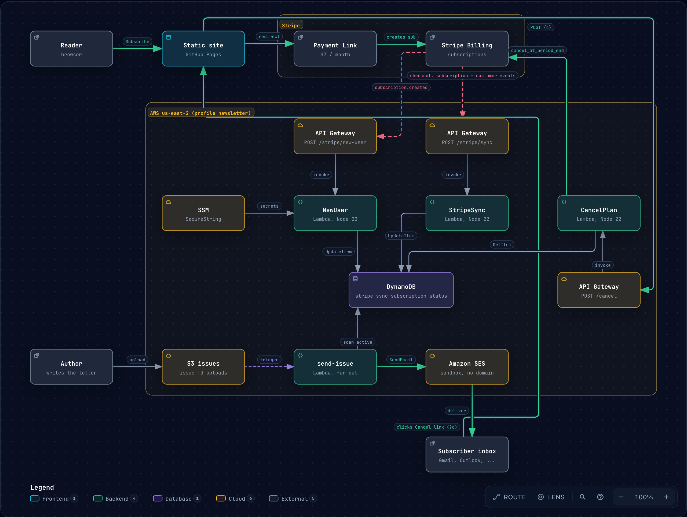

# Personal Portfolio

Static portfolio site, hosted on GitHub Pages. No build step or dependencies.

## Files

| File | Purpose |
|------|---------|
| `index.html` | Home page. Styles in `index.css`, behaviour in `home.js` |
| `book.html` | Consultation booking page (Cal.com popup) |
| `terms.html`, `privacy.html`, `consent.html`, `contact.html` | Legal and contact pages |
| `unsubscribe.html` | Cancel page, reached only from the link in each letter (not linked from the site, marked `noindex`) |
| `404.html` | Custom "page not found" page |
| `config.js` | Site settings: booking link, newsletter subscribe link, cancel endpoint |
| `base.css`, `index.css`, `pages.css` | Shared and page-specific styles |
| `site.js`, `home.js` | Shared helpers and the home page script |
| `favicon.svg`, `theme-icon.svg` | Icons |
| `robots.txt`, `.nojekyll` | Search engine rules; serve files as-is on GitHub Pages |

## Newsletter architecture

The paid newsletter runs on Stripe and AWS. Its backend lives outside this repository; the overview:

